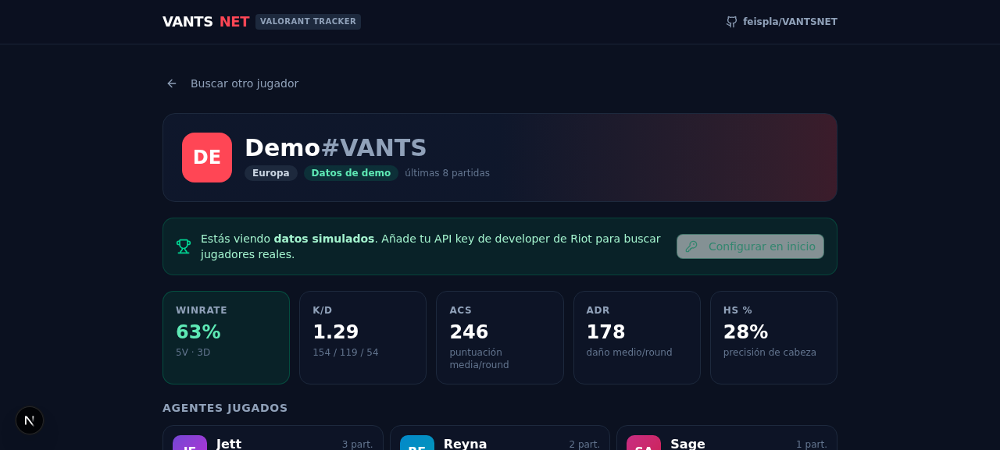
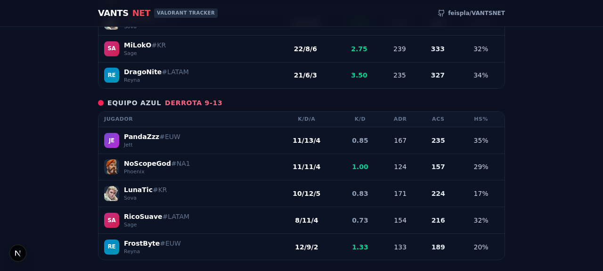
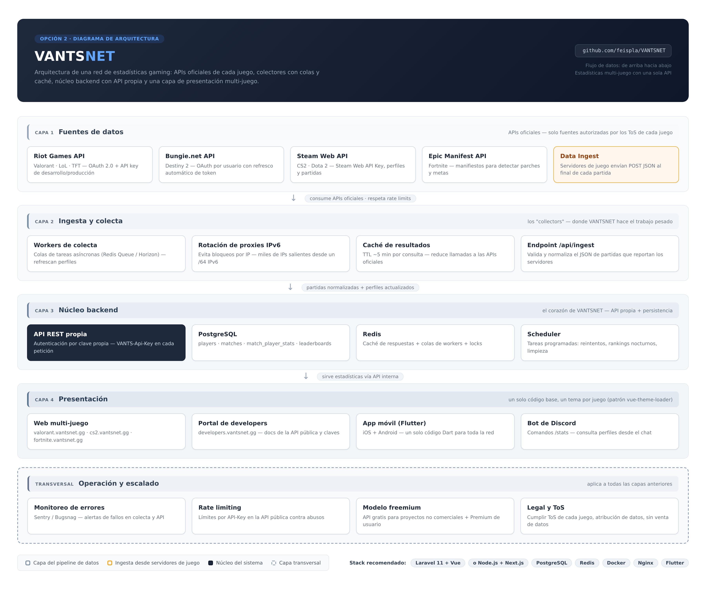

# VANTSNET

> Red de estadísticas gaming y plataforma competitiva — un solo backend, varios juegos, una comunidad.

**VANTSNET** es una plataforma de estadísticas de videojuegos y ecosistema competitivo: perfiles de jugadores, historial de partidas, torneos con equipos e inscripciones, y una API pública propia. La arquitectura replica los patrones de las plataformas líderes del sector: colectores con caché, persistencia única de partidas, API con autenticación y una capa de presentación multi-juego.

## Prototipo funcional (este repositorio)

Este repo ya incluye un **prototipo funcional de la red** construido con la ruta moderna del stack (Next.js 16 + TypeScript + Tailwind 4 + Prisma), con el juego Valorant como primera integración:

- **Modo demo inmediato**: busca `Demo#VANTS` (región Europe) sin ninguna API key — 8 partidas simuladas de forma determinista con estadísticas agregadas (winrate, K/D, ACS, ADR, HS%) y scoreboard por partida.
- **Ruta real con Riot API**: con una clave de [developer.riotgames.com](https://developer.riotgames.com) resuelve Riot IDs reales (`Nombre#TAG`) vía `account-v1` y verifica cuentas en tiempo real. Los endpoints de partidas de Valorant (`VAL-MATCH-V1`) están reservados por Riot para claves de producción — la app lo detecta, lo explica y muestra la cuenta ya verificada. El expediente para solicitar esa clave está en [`docs/SOLICITUD-CLAVE-PRODUCCION.md`](docs/SOLICITUD-CLAVE-PRODUCCION.md).
- **Primer endpoint de Steam (Fase 4)**: `GET /api/steam/resolve?query=<steamid64|vanity>` resuelve perfiles de Steam (SteamID64, vanity URL o URL completa) y la biblioteca de juegos pública vía Steam Web API.
- **Ecosistema competitivo (nuevo)**: torneos con estados (borrador → inscripción → en juego → completado), equipos con plantillas, inscripciones anti-duplicado, partidas con resultados validados y **registro de auditoría** completo. Se gestiona desde la vista «Competitivo» de la app (botón en la cabecera) con token de administración.
- **Discord OAuth2 y FACEIT** (nuevo): módulos de integración implementados con estados honestos «no configurado» hasta definir las credenciales — guía en [`docs/INTEGRATIONS.md`](docs/INTEGRATIONS.md).
- **Panel de estado**: pestaña «Estado» y `GET /api/health` muestran la salud real del servicio y qué integraciones están activas (sin exponer secretos).

### Calidad y CI

| Check | Herramienta | Estado |
|-------|-------------|--------|
| Lint + Typecheck + Tests + Build | GitHub Actions (`ci.yml`, Bun con lockfile congelado) | Ejecuta en cada push/PR |
| Análisis semántico de seguridad | **CodeQL** (`security-extended`, JS/TS) | Gratis en repo público |
| Quality Gate | **SonarCloud** | Se auto-omite hasta añadir `SONAR_TOKEN` |
| Dependencias | Dependabot (npm + actions, semanal) | Activo tras merge |

14 tests de unidad (Vitest) cubren la lógica crítica: state anti-CSRF de Discord, validadores zod, reglas de partidas de torneo, slugify. Ver [`docs/TESTING.md`](docs/TESTING.md).

| Captura | Vista |
|---------|-------|
|  | Perfil con estadísticas agregadas |
|  | Scoreboard de una partida |

### Puesta en marcha

```bash
bun install            # o npm install
cp .env.example .env   # opcional: añade tus claves (Riot/Steam/admin/Discord/FACEIT)
bun run db:update      # aplica el contrato (Prisma ORM 8) a la BD
bun run dev            # o npm run dev → http://localhost:3000

bun run lint        # ESLint
bun run typecheck   # tsc --noEmit
bun run test        # vitest (14 tests)
bun run build       # build de producción
```

Variables de entorno (referencia completa en [`docs/ENVIRONMENT.md`](docs/ENVIRONMENT.md)):

| Variable | Obligatoria | Descripción |
|----------|-------------|-------------|
| `DATABASE_URL` | Sí | PostgreSQL (Prisma Postgres, Neon o local); la plataforma Prisma la aprovisiona al desplegar ([`docs/DATABASE.md`](docs/DATABASE.md)) |
| `RIOT_API_KEY` | No | Clave de Riot: habilita la verificación real de Riot IDs. Sin ella, solo el modo demo |
| `STEAM_API_KEY` | No | Clave gratuita de Steam Web API: habilita `/api/steam/resolve` |
| `ADMIN_TOKEN` | Para admin | Mutaciones de torneos/equipos (header `X-Admin-Token`); sin él, `503` honesto |
| `DISCORD_*` | Para Discord | OAuth2 identidad (`CLIENT_ID`, `CLIENT_SECRET`, `OAUTH_STATE_SECRET`, `REDIRECT_URI`) |
| `FACEIT_API_KEY` | Para FACEIT | Server key de FACEIT Data API v4 |

> Las claves viven **solo en el backend** (`.env`, excluido del repo por `.gitignore`) y nunca se exponen al cliente.

### Endpoints del prototipo

| Endpoint | Descripción |
|----------|-------------|
| `GET /api/valorant/profile?riotId=Nombre#TAG&region=europe` | Perfil agregado: winrate, K/D, ACS, ADR, HS%, agentes y últimas partidas. `Demo#VANTS` siempre sirve datos demo |
| `GET /api/valorant/match/{matchId}` | Scoreboard completo de una partida (desde la caché en BD o colectada una única vez desde Riot) |
| `GET /api/steam/resolve?query=<steamid64\|vanity>` | Perfil de Steam + top de juegos por tiempo de juego (requiere perfil público para la biblioteca) |
| `GET /api/health` | Estado del servicio y de integraciones (booleanos, sin secretos) |
| `GET /api/tournaments` · `GET /api/tournaments/{id}` | Torneos (lista/detalle con inscripciones y partidas) — público |
| `GET /api/teams` | Equipos con plantillas — público |
| `POST/PATCH /api/tournaments/...` · `POST /api/teams/...` | Mutaciones competitivas — exigen `X-Admin-Token`; registran auditoría |
| `GET /api/faceit/player?nickname=X` | Jugador FACEIT + historial reciente (503 honesto sin clave) |
| `GET /api/auth/discord/start` · `status` | Inicio del enlace Discord OAuth y estado de configuración |

## Arquitectura



La arquitectura completa está documentada en [`docs/ARQUITECTURA.md`](docs/ARQUITECTURA.md) (incluye el diagrama en formato Mermaid que GitHub renderiza nativamente).

| Capa | Responsabilidad | Componentes clave |
|------|----------------|-------------------|
| **1 · Fuentes de datos** | APIs oficiales de cada juego | Riot Games API (integrada), Steam Web API (integrada), Bungie.net API, Epic Manifest API, Data Ingest |
| **2 · Ingesta y colecta** | Workers, proxies y caché | Colas Redis, rotación de proxies IPv6, caché TTL ~5 min, endpoint `/api/ingest` |
| **3 · Núcleo backend** | API propia + persistencia | API REST (`VANTS-Api-Key`), PostgreSQL, Redis, scheduler |
| **4 · Presentación** | Interfaces para jugadores | Web multi-juego, portal de developers, app Flutter, bot de Discord |
| **Transversal · Operación** | Escalar y cumplir reglas | Monitoreo, rate limiting, freemium, legal/ToS |

El prototipo ya aplica el patrón central del blueprint: **caché en base de datos** (cada partida se colecta una única vez desde la API oficial y se sirve después desde la capa 3).

## Stack tecnológico

- **Prototipo (este repo)**: Next.js 16 + TypeScript + Tailwind 4 + Prisma ORM 8/PostgreSQL — la "ruta moderna" del stack
- **Backend producción (planificado)**: Laravel 11 + Vue (ruta clásica) o Node.js + Next.js
- **Base de datos**: PostgreSQL (jugadores, partidas, estadísticas) + Redis (caché y colas)
- **Infraestructura**: Docker + Nginx
- **Móvil**: Flutter (un solo código para iOS y Android)

## Estructura del repositorio

```
VANTSNET/
├── src/                     # Prototipo funcional (Next.js 16 + TypeScript + Tailwind 4)
│   ├── app/                 # UI (buscador/perfil/partida) + API routes (valorant, steam)
│   ├── components/          # Vistas de la red de estadísticas + componentes UI
│   └── lib/                 # Clientes de APIs oficiales (Riot, Steam) + datos demo
├── src/prisma/              # Contrato Prisma 8: 11 modelos (Player, Match, torneos...)
├── prisma.config.ts         # Config del ORM (contrato + conexión)
├── docs/
│   ├── ARQUITECTURA.md      # Arquitectura completa del blueprint + diagrama Mermaid + SQL
│   ├── ROADMAP.md           # Plan de construcción en 5 fases con criterios de aceptación
│   ├── SOLICITUD-CLAVE-PRODUCCION.md  # Expediente para la Production Key de Riot (VALORANT)
│   └── img/                 # Capturas del prototipo (evidencia para la solicitud)
├── scripts/                 # Regeneración del diagrama de arquitectura (HTML + Playwright)
├── arquitectura-vantsnet.png
└── .env.example
```

Carpetas planificadas para las siguientes fases: `ingest/` (colectores por juego), `backend/` (API REST + workers), `mobile/` (Flutter), `deploy/` (Docker, Nginx, CI).

## Hoja de ruta

| Fase | Entregable | Estado |
|------|-----------|--------|
| 1 | Colector Valorant (Riot API) + esquema inicial de BD | 🧪 Prototipo funcional |
| 2 | API REST propia + caché + colas | 🧪 Prototipo (API routes + caché en BD) |
| 3 | Web de estadísticas (perfil, historial, matches) | 🧪 Prototipo funcional |
| 4 | Multi-juego con sistema de temas + ingesta de servidores | 📋 Planificado — cliente de Steam Web API ya integrado |
| 5 | App Flutter, bot de Discord, API pública y Premium | 📋 Planificado |

## Legal

- Usar **solo** APIs oficiales de cada juego y respetar sus términos de servicio (el programa de desarrolladores de Riot, por ejemplo, restringe algunos usos comerciales).
- Atribuir la fuente de datos en la interfaz ("Datos de Riot Games" / "Datos de Steam").
- Respetar la privacidad de los jugadores: en Steam solo se leen datos públicos (perfiles públicos; los detalles de juego privados se detectan y se comunican claramente).
- No vender datos personales; monetizar mediante suscripciones Premium (cosméticos, ventajas de búsqueda) y cuotas de API para uso comercial.
