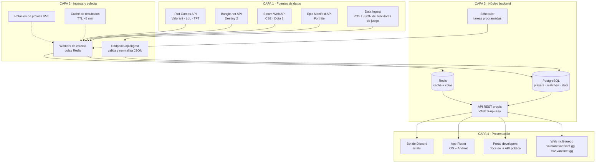

# Arquitectura de VANTSNET

Este documento describe cómo está diseñada la red de estadísticas VANTSNET, aplicando los patrones probados de las grandes plataformas de estadísticas gaming del sector. VANTSNET replica ese pipeline completo — APIs oficiales → colectores → base de datos → API propia → frontends — adaptado a un proyecto que puede arrancar un solo desarrollador y escalar después.

## Diagrama



## Capa 1 — Fuentes de datos

VANTSNET solo consume **APIs oficiales**. Es la regla número uno: garantiza legalidad, estabilidad de los datos y cumplimiento de los ToS de cada editor. Cada juego aporta una (o dos) vías de entrada de datos:

- **Riot Games API** (Valorant, LoL, TFT): acceso gratuito con clave de desarrollo; la de producción se solicita cuando la app está lista. Autenticación con API key y, para cuentas de usuario, OAuth 2.0. Rate limits por clave de 2 segundos / 120 minutos que obligan a diseñar la colecta con colas.
- **Bungie.net API** (Destiny 2): requiere OAuth por usuario con token y refresco automático; es la integración más exigente de las tres y sirve como buen ejercicio antes de escalar a más juegos (el patrón de referencia open source usa Laravel 7 + caché de 5 minutos + proxy configurable).
- **Steam Web API** (CS2, Dota 2): la más simple; una sola clave da acceso a perfiles, historiales y estadísticas.
- **Epic Manifest API** (Fortnite): existe una librería open source (`EpicManifestParser`, C#) para detectar parches; para VANTSNET basta leer los manifiestos JSON para publicar notas de parche.
- **Data Ingest** (opcional, avanzado): los servidores de juego privados (por ejemplo, servidores comunitarios) envían un POST JSON al final de cada partida al endpoint de ingesta. Es un patrón extendido entre las plataformas de estadísticas y permite tener estadísticas que las APIs oficiales no exponen.

## Capa 2 — Ingesta y colecta

Es donde VANTSNET hace el trabajo pesado y donde casi todos los proyectos de este tipo fallan si no planifican. Sus cuatro componentes resuelven los cuatro problemas clásicos:

1. **Rate limits** → los *workers de colecta* nunca llaman a las APIs en línea desde el request del usuario; encolan la tarea (Redis Queue con Laravel Horizon, o BullMQ con Node) y un worker la procesa respetando los límites.
2. **Bloqueo por IP** → la *rotación de proxies IPv6*: con un /64 de IPv6 se generan miles de IPs salientes y cada worker sale por una distinta (patrón documentado en repos open source del sector).
3. **Coste de API** → la *caché de resultados* con TTL de ~5 minutos: si diez usuarios buscan al mismo jugador en cinco minutos, solo se consume una llamada a la API del juego. Es exactamente la política de `DestinyStatus`.
4. **Datos de partidas** → el *endpoint `/api/ingest`* recibe el JSON de servidores de juego, valida el schema y normaliza los nombres de campo antes de persistir.

## Capa 3 — Núcleo backend

- **API REST propia** autenticada con `VANTS-Api-Key`. Los endpoints siguen el patrón `/{game}/{tipo}/{recurso}`, por ejemplo `/v1/valorant/profile/EUW/Nombre#TAG`.
- **PostgreSQL** con el esquema inicial:

```sql
CREATE TABLE players (
    id            BIGSERIAL PRIMARY KEY,
    game          VARCHAR(20)  NOT NULL,          -- 'valorant', 'cs2', ...
    external_id   VARCHAR(64)  NOT NULL,          -- puuid / steamid / membershipId
    riot_id       VARCHAR(64),                    -- 'Nombre#TAG' para juegos Riot
    display_name  VARCHAR(128),
    region        VARCHAR(8),
    avatar_url    TEXT,
    last_fetched_at TIMESTAMPTZ,
    UNIQUE (game, external_id)
);

CREATE TABLE matches (
    id          BIGSERIAL PRIMARY KEY,
    game        VARCHAR(20)  NOT NULL,
    external_id VARCHAR(64)  NOT NULL,            -- matchId del juego
    played_at   TIMESTAMPTZ  NOT NULL,
    map         VARCHAR(64),
    mode        VARCHAR(32),
    duration_s  INTEGER,
    raw         JSONB,                            -- payload original comprimido
    UNIQUE (game, external_id)
);

CREATE TABLE match_player_stats (
    id         BIGSERIAL PRIMARY KEY,
    match_id   BIGINT REFERENCES matches(id),
    player_id  BIGINT REFERENCES players(id),
    team       SMALLINT,
    kills      SMALLINT, deaths SMALLINT, assists SMALLINT,
    stats      JSONB                             -- resto de métricas por juego
);

CREATE TABLE leaderboards (
    id         BIGSERIAL PRIMARY KEY,
    game       VARCHAR(20) NOT NULL,
    region     VARCHAR(8),
    metric     VARCHAR(32) NOT NULL,             -- 'kills', 'winrate', ...
    period     DATE NOT NULL,                    -- día/semana del ranking
    ranked     JSONB NOT NULL
);
```

- **Redis** cumple doble función: caché de respuestas calientes y broker de las colas de la capa 2.
- **Scheduler** para tareas programadas: reintentos con backoff, recálculo nocturno de leaderboards y limpieza de `raw` antiguo.

## Capa 4 — Presentación

La idea que hace escalables a estas plataformas es **un solo código base con un tema por juego** (patrón `vue-theme-loader`). VANTSNET aplica el mismo principio: la app web carga colores, logo y rutas según el subdominio — `valorant.vantsnet.gg`, `cs2.vantsnet.gg`, `fortnite.vantsnet.gg` — sin duplicar lógica. El portal `developers.vantsnet.gg` documenta la API pública y gestiona las claves; la app Flutter reutiliza la misma API; y el bot de Discord expone comandos `/stats` para consultar perfiles sin salir del chat.

## Capa transversal — Operación

- **Monitoreo**: Sentry o Bugsnag desde el día uno; cada fallo de colecta debe alertar, no engullirse en silencio.
- **Rate limiting** en la API pública por API-Key para proteger la infraestructura de abusos.
- **Modelo freemium**: API gratuita para proyectos no comerciales + suscripción Premium con ventajas de producto, nunca venta de datos.
- **Legal**: atribución visible de las fuentes ("Datos de Riot Games"), respeto de los ToS de cada editor y opción de borrado de perfil a petición del jugador.

## Arquitectura implementada (prototipo, fase de completación)

Esta sección describe lo que **existe y funciona** en el código actual; todo lo anterior es el blueprint hacia el que evoluciona.

### Mapa de módulos

```
src/
├── app/
│   ├── page.tsx                     # SPA raíz (buscador / perfil / partida / competitivo)
│   ├── layout.tsx                   # Shell + metadatos
│   └── api/
│       ├── health/                  # GET  estado del servicio (booleanos, sin secretos)
│       ├── valorant/                # profile, match/[matchId] (demo + ruta real Riot)
│       ├── steam/resolve/           # perfil Steam por SteamID64/vanity
│       ├── faceit/player/           # FACEIT Data API v4 (503 honesto sin clave)
│       ├── auth/discord/            # start / callback / status / link (OAuth identify)
│       ├── teams/                   # GET público, POST admin; members/[memberId] admin
│       ├── tournaments/             # GET/POST + [id] GET/PATCH + registrations + matches
│       └── admin/audit/             # GET últimos registros de auditoría
├── components/vantsnet/             # Vistas de la SPA (search, profile, match, hub, tournament-detail)
├── lib/
│   ├── valorant/riot.ts             # Cliente Riot tipado + agregación (capa 3 del blueprint)
│   ├── valorant/demo-data.ts        # Fixture determinista (solo demo, claramente marcado)
│   ├── steam/steam.ts               # Cliente Steam Web API
│   ├── discord.ts                   # OAuth2: state HMAC, exchange, users/@me
│   ├── faceit.ts                    # Cliente FACEIT v4 con errores tipados
│   ├── admin.ts                     # Guard X-Admin-Token (timing-safe)
│   ├── audit.ts                     # Escritura de AuditLog
│   ├── validators.ts                # Schemas zod de la frontera API
│   └── db.ts                        # Prisma client singleton
└── tests/unit.test.ts               # Vitest: lógica crítica sin red/BD
```

### Decisiones estructurales

1. **Una ruta visual (`/`) con vistas en Zustand** — coherente con el despliegue SPA y el gateway; el hub «Competitivo» es una vista más, no un árbol de rutas paralelo.
2. **Validación en frontera** — todo body de mutación pasa por zod antes de tocar la BD; los errores del proveedor se traducen a códigos estables (`NOT_CONFIGURED`, `DUPLICATE_REGISTRATION`, `FORBIDDEN_PRODUCT`…).
3. **Estados honestos por diseño** — una integración sin credenciales responde `503` con guía; los datos demo viven solo en `demo-data.ts` y se marcan como demo en la respuesta (`demo: true`) y en la UI.
4. **Fuentes de verdad separadas** — los torneos/equipos son registros propios de VANTSNET; los datos de Riot/Steam/FACEIT se importan y se referencian (`TournamentMatch.externalMatchRef`), nunca se mezclan.
5. **Idempotencia** — `ProviderIdentity` y `TournamentRegistration` tienen constraints únicos; la sincronización repetida no crea duplicados.
6. **Auditoría de mutaciones** — toda acción admin registra actor/acción/entidad/detalle en `AuditLog`.
